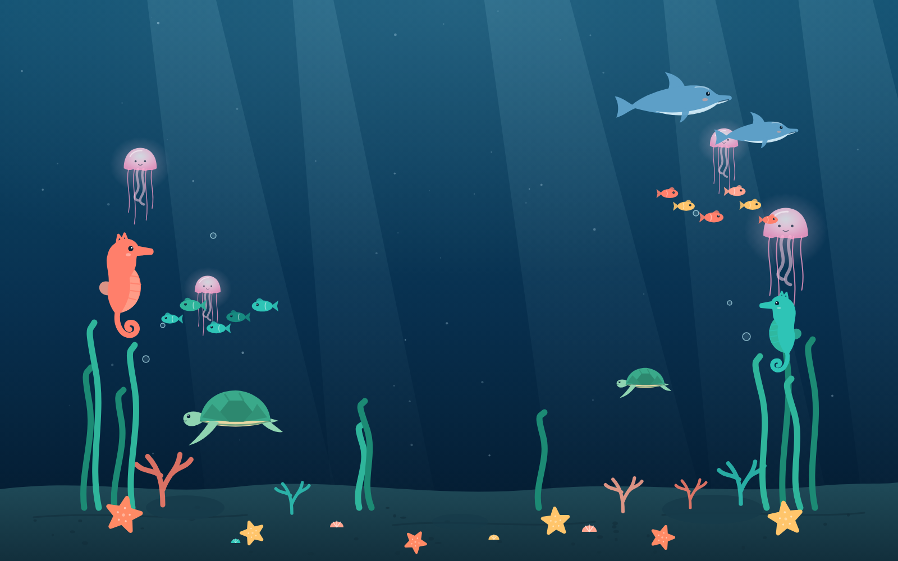
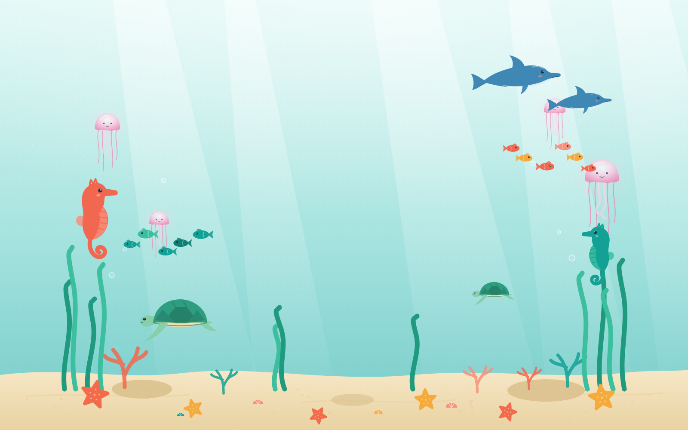

# Ocean Theme

A calm but lively underwater theme for the Claude Code desktop app. It draws an animated ocean scene behind your conversation: sunlight filtering down from the surface, cute sea creatures swimming along the edges, and a sandy seabed.





*The scene with motion turned off. With motion on, the creatures swim, drift and pulse.*

## Features

- **Two scenes:** dark (deep ocean navy) and light (turquoise and sand)
- **Colors:** coral orange-pink accents, with sea green and turquoise as the secondary color
- **Sea creatures** (all original SVG drawings):
  - a pod of dolphins that swims across and now and then leaps in an arc
  - turtles that glide slowly, flapping their flippers
  - seahorses that bob up and down, curling their tails
  - glowing jellyfish that pulse as they rise, tentacles waving
  - small schools of fish and rising bubbles
  - starfish turning slowly in the sand, and swaying seaweed
- Creatures move at different times and speeds, so the screen never fills up at once. They stay along the edges and in the background, and the conversation stays readable behind frosted glass.
- Pure CSS and SVG animation, so it stays light on performance.

## Install

In a terminal session:

```
/plugin install ocean-theme --marketplace elifabanoz/ocean-theme
```

From a shell:

```
claude plugin install ocean-theme --marketplace elifabanoz/ocean-theme
```

In the desktop app, where `/plugin` does not run: click **+** next to the prompt box, then **Plugins**, **Add marketplace** with `elifabanoz/ocean-theme`, then **Add plugin**.

The backdrop needs an up-to-date Claude Code desktop app and a local session in the **Code** tab.

## Usage

| Command | What it does |
| --- | --- |
| `/ocean` | Opens the settings panel |
| `/ocean dark` | Deep navy scene |
| `/ocean light` | Light turquoise and sand scene |
| `/ocean full` | Full motion |
| `/ocean reduced` | Slower, calmer motion with fewer extras |
| `/ocean still` | Turns motion off (the scene stays) |
| `/ocean off` / `/ocean on` | Removes the theme / brings it back |
| `/ocean status` | Shows whether the theme is drawn |

Your settings are remembered across sessions. For the best contrast, set the app's own appearance to the same mode as the scene (dark or light).

## License

MIT
